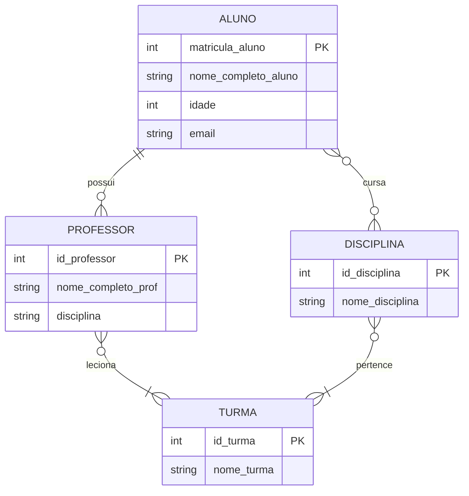
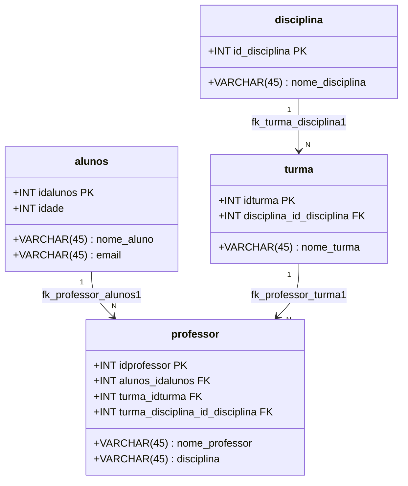

# 🏫 Sistema de Banco de Dados Escolar


Repositório dedicado ao projeto de **Modelagem Conceitual e Lógica de Banco de Dados Relacional** para gerenciamento escolar. O projeto abrange a representação de entidades acadêmicas fundamentais como **Alunos**, **Professores**, **Turmas** e **Disciplinas**, bem como seus relacionamentos e regras de negócio.

---

## 📌 Conteúdo do Repositório

- **[Conceptual model  escola.pdf](./Conceptual%20model%20%20escola.pdf)**: Diagrama Entidade-Relacionamento (DER / Modelo Conceitual) desenvolvido no [brModelo Web](https://app.brmodeloweb.com/).
- **[escola.mwb](./escola.mwb)**: Modelo Físico/Lógico original editável no **MySQL Workbench**.
- **[escola.pdf](./escola.pdf)**: Visualização gráfica exportada do diagrama relacional do MySQL Workbench.
- **[escola.sql](./escola.sql)**: Script SQL DDL de criação do banco de dados e suas respectivas tabelas, chaves primárias e estrangeiras.

---

## 📐 Modelagem de Dados

### 1. Modelo Conceitual (DER)
Representa a visão de alto nível do sistema escolar, destacando as entidades do domínio, seus atributos e as cardinalidades de associação.



### 2. Modelo Lógico / Relacional (MER)
Estrutura normalizada com os tipos de dados primitivos (`INT`, `VARCHAR`), restrições de integridade (`PRIMARY KEY`, `FOREIGN KEY`):



---

## 🗄️ Dicionário de Dados

### Tabela: `alunos`
Armazena as informações cadastrais dos discentes matriculados.

| Campo | Tipo | Nulo | Chave | Descrição |
| :--- | :--- | :---: | :---: | :--- |
| `idalunos` | `INT` | ❌ | PK | Identificador único do aluno |
| `nome_aluno` | `VARCHAR(45)` | ✔️ | - | Nome completo do aluno |
| `idade` | `INT` | ✔️ | - | Idade do aluno |
| `email` | `VARCHAR(45)` | ✔️ | - | Endereço de e-mail de contato |

---

### Tabela: `disciplina`
Armazena o catálogo de matérias/disciplinas oferecidas pela instituição.

| Campo | Tipo | Nulo | Chave | Descrição |
| :--- | :--- | :---: | :---: | :--- |
| `id_disciplina` | `INT` | ❌ | PK | Identificador único da disciplina |
| `nome_disciplina` | `VARCHAR(45)` | ✔️ | - | Nome da matéria/disciplina |

---

### Tabela: `turma`
Organização dos alunos e disciplinas em turmas específicas.

| Campo | Tipo | Nulo | Chave | Descrição |
| :--- | :--- | :---: | :---: | :--- |
| `idturma` | `INT` | ❌ | PK | Identificador da turma |
| `nome_turma` | `VARCHAR(45)` | ✔️ | - | Código/nome de identificação da turma |
| `disciplina_id_disciplina` | `INT` | ❌ | FK | Chave estrangeira referenciando a `disciplina` |

---

### Tabela: `professor`
Armazena os docentes e suas vinculações pedagógicas com turmas e alunos.

| Campo | Tipo | Nulo | Chave | Descrição |
| :--- | :--- | :---: | :---: | :--- |
| `idprofessor` | `INT` | ❌ | PK | Identificador único do professor |
| `nome_professor` | `VARCHAR(45)` | ✔️ | - | Nome completo do professor |
| `disciplina` | `VARCHAR(45)` | ✔️ | - | Área de especialização do docente |
| `alunos_idalunos` | `INT` | ❌ | FK | Referência ao aluno |
| `turma_idturma` | `INT` | ❌ | FK | Referência à turma |
| `turma_disciplina_id_disciplina`| `INT` | ❌ | FK | Referência composta à disciplina vinculada à turma |

---

## 🚀 Como Utilizar este Projeto

### Abrir o modelo no MySQL Workbench
1. Certifique-se de ter o [MySQL Workbench](https://dev.mysql.com/downloads/workbench/) instalado.
2. Abra o programa e clique em **File > Open Model**.
3. Selecione o arquivo [`escola.mwb`](./escola.mwb) presente na raiz deste repositório.

### Executar o script SQL no seu Banco de Dados
Você pode executar diretamente via terminal ou através de qualquer cliente SQL (DBeaver, MySQL Workbench, phpMyAdmin):

```bash
# Via terminal MySQL
mysql -u seu_usuario -p < escola.sql
```

---

## 🛠️ Tecnologias Utilizadas

- **[brModelo Web](https://app.brmodeloweb.com/)**: Criação do diagrama conceitual (DER).
- **[MySQL Workbench](https://www.mysql.com/products/workbench/)**: Modelagem relacional visual e geração dos arquivos `.mwb`.
- **MySQL / SQL (DDL)**: Criação das tabelas e definição de constraints relacionais.
- **Git & GitHub**: Versionamento de código e documentação.

---

## 👤 Autor

Desenvolvido por **[Clauber Correa](https://github.com/claubercorrea)**.
